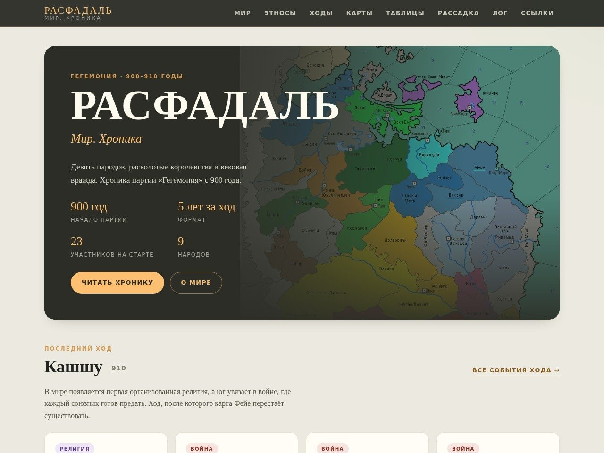
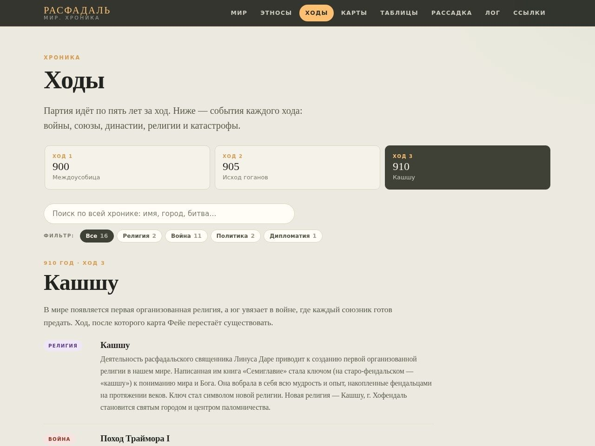
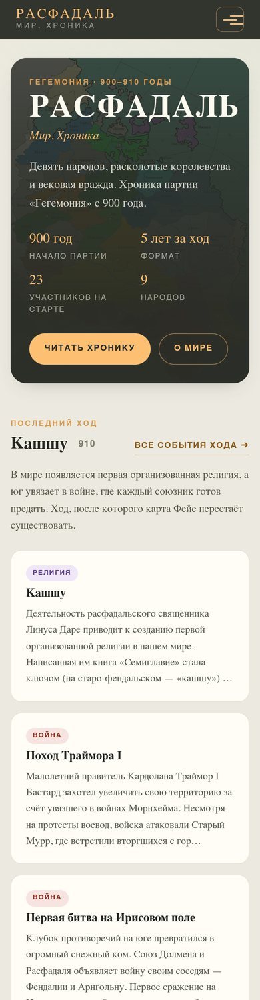

# Расфадаль. Мир. Хроника

**Сайт:** <https://bescherepov.github.io/gemelch26-fantasy/>

Сайт-хроника партии «Гегемония» (900–910 гг.), собранный по принципу **единого источника информации**: весь контент описан в `data/*.json`, страницы генерируются скриптом, публикация — через GitHub Actions на GitHub Pages.

Полное описание архитектуры — в [CONCEPT.md](CONCEPT.md).

## Превью







## Что умеет сайт

- мир, девять народов, летопись 400–900 и законы Айзенвелла;
- ходы 900 / 905 / 910 с картами, фильтром по типам событий и поиском по всей хронике;
- переходы между ходами, статистика событий, карты и таблицы с фильтрами;
- справочник построек: 136 карточек с поиском, разделами и местными правилами партии;
- лог изменений, который собирается из истории git;
- адаптивная вёрстка, работа без JavaScript, статический 404 и sitemap.

## Быстрый старт

Нужен только Python 3.9+ (никаких пакетов, npm и сборщиков).

```bash
python build.py                       # собрать сайт в dist/
python scripts/validate.py            # проверить данные
python -m unittest discover -s tests  # 36 тестов движка и сборки
python -m http.server 8000 -d dist
```

Откройте <http://localhost:8000>.

## Что внутри

| Путь | Назначение |
| --- | --- |
| `data/` | Единственный источник правды: мир, народы, история, ходы, карты, постройки, ссылки |
| `data/turns/*.json` | По одному файлу на ход |
| `templates/` | HTML-шаблоны (движок — `engine.py`, без зависимостей) |
| `assets/` | CSS, JS и изображения |
| `build.py` | Генерация `dist/` |
| `scripts/validate.py` | Проверка данных и ссылок |
| `scripts/changelog.py` | Дополнение лога из истории git |
| `tests/` | Тесты движка шаблонов и интеграционные тесты сборки |
| `sources/` | Исходники от мастера: Setting.docx и тексты ходов |
| `.github/workflows/pages.yml` | CI/CD: проверка → тесты → сборка → публикация |

## Как добавить ход

1. Положите карту в `assets/img/` и добавьте запись в `data/maps.json`.
2. Создайте `data/turns/915.json` по образцу соседнего хода.
3. Запустите `python scripts/validate.py`, `python -m unittest discover -s tests` и `python build.py`.
4. Закоммитьте изменения: `Добавлен 4-й ход (915 г.)`.

Лог изменений собирается автоматически из коммитов, которые трогают `data/`. Переходы между ходами, статистика, навигация и поиск пересоберутся сами.

## Публикация

Пайплайн уже настроен: **Settings → Pages → Build and deployment → Source: GitHub Actions**.
Каждый пуш в `main` пересобирает и публикует сайт. Pull request получает собранный артефакт `site-preview` без публикации.

## Лицензия

Код — MIT (см. [LICENSE](LICENSE)). Игровые материалы принадлежат мастеру и участникам партии.
